# Dev7d — Containerised Nexus Deployment on DigitalOcean

**Deploying Sonatype Nexus Repository Manager as a Docker container on an Ubuntu cloud server, with persistent Docker-managed storage**

   

> **Project lineage:** [Dev6 — Nexus for Java artifacts](https://github.com/ChiomaScripts/Dev6-nexus-artifact-repository) → [Dev7b — Nexus as a private Docker registry](https://github.com/ChiomaScripts/Dev7b-docker-nexus-registry) → **Dev7d — Running Nexus itself inside Docker**. The shared software is Nexus; the engineering objectives are different.

---

## 01 — Executive Summary

This project demonstrates a concise alternative to installing Sonatype Nexus Repository Manager directly on a Linux host: running the repository manager as a **containerised application** on a DigitalOcean Ubuntu Droplet. The exercise was completed in under an hour, reflecting the reduced setup work involved in pulling and starting a prebuilt image rather than manually preparing an application runtime and installing the service.

I provisioned a new Ubuntu Droplet, installed Docker using Ubuntu's `docker.io` package, created a persistent named volume, and launched `sonatype/nexus3` with its web interface published on port **8081**. I then accessed the Nexus login screen and dashboard, inspected the container's shell and runtime identity, and located the Nexus data files on the Docker host through volume inspection.

**Scope:** A single-container Nexus deployment and operational verification. This project does **not** claim to have created hosted repositories, published new artifacts, tested backup restoration, or verified persistence by deleting and recreating the container. Those are separate activities or possible extensions.

### Objectives and observed results

| Objective | Evidence / outcome |
|---|---|
| Provision a remote Ubuntu host | DigitalOcean Droplet created |
| Install and verify Docker | `docker.io` installed; Docker version output captured |
| Configure durable storage | Named volume `nexus-data` created and inspected |
| Run Nexus as a container | `sonatype/nexus3` image pulled and container `chioma_nexus` started |
| Reach Nexus through the browser | Initial login screen and dashboard captured |
| Investigate runtime and data | `/bin/sh` access, `whoami` output and volume contents observed |

---

## 02 — Background, Motivation and Comparison with Earlier Projects

Nexus Repository Manager is a server application for storing and managing software components and artifacts. It can run as a conventional host-managed service or as a container. This project explores the second model: **Docker packages the application and its runtime environment into an image**, and the host supplies the Docker Engine, networking and persistent storage.

The exercise is distinct from:

- **[Dev6 — Nexus Artifact Repository Management](https://github.com/ChiomaScripts/Dev6-nexus-artifact-repository):** focused on deploying and configuring Nexus for Java artifact publication with Gradle and Maven.
- **[Dev7b — Private Docker Registry with Nexus](https://github.com/ChiomaScripts/Dev7b-docker-nexus-registry):** focused on configuring a Nexus Docker hosted repository, registry authentication and pushing a FastAPI image.
- **[Dev7c — Docker Compose & Persistent MongoDB](https://github.com/ChiomaScripts/Dev7c-docker-compose-volumes):** used declarative multi-container orchestration and a Docker named volume for MongoDB. Here, the same storage principle is applied to a **single infrastructure application** using `docker run`.

The main lesson is that *containerising an infrastructure service changes its packaging and deployment workflow, not its need for state management, security, monitoring or backups*.

---

## 03 — Architecture and Data Flow

```text
                     Browser / administrator
                              |
                     HTTP :8081 (lab only)
                              |
                    DigitalOcean public IP
                              |
                 Ubuntu Droplet / Docker Engine
                              |
                    host TCP 8081 → 8081
                              |
                  +------------------------+
                  | chioma_nexus container |
                  | image: sonatype/nexus3 |
                  | app data: /nexus-data  |
                  +-----------+------------+
                              |
                     Docker volume mount
                              |
                    named volume: nexus-data
                              |
            /var/lib/docker/volumes/nexus-data/_data
                 (observed host mountpoint)
```

**What each layer does:**

- **DigitalOcean Droplet:** Provides a remote Ubuntu virtual machine, compute, disk and network connectivity.
- **Docker Engine:** Downloads the image, creates the container, manages its process and publishes ports.
- **Nexus container:** Runs the repository manager process and serves the web interface on internal port 8081.
- **Port mapping `8081:8081`:** Forwards connections from host port 8081 to container port 8081. The captured `docker ps` output shows the service published on all host interfaces, including IPv4 and IPv6.
- **Named volume `nexus-data`:** Keeps Nexus application data outside the container's writable layer, so the data can remain after container removal unless the volume itself is deleted.

> **Security note:** The demonstrated web interface was reached over HTTP on a public IP. That is suitable only as a short-lived, access-restricted learning setup. A long-running deployment should use HTTPS, limit administrative access and avoid exposing Nexus broadly to the internet.

---

## 04 — Provisioning the DigitalOcean Ubuntu Droplet

I created a new DigitalOcean Droplet for the Nexus container exercise. The captured control-panel view shows the Droplet as active, with an Ubuntu 24.04 LTS x64 image. The shell prompt in subsequent screenshots identifies a 2-vCPU / 4-GB Ubuntu Droplet in the London region.

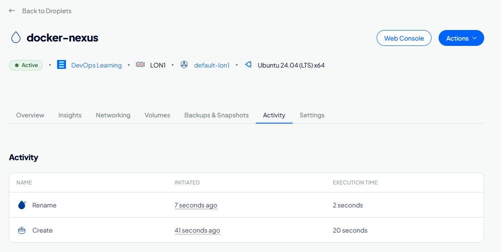

*Evidence 01 — DigitalOcean activity panel showing the newly created server.*

I accessed the server through a root SSH session. This is what the evidence shows; for a longer-lived environment, a dedicated administrator account with key-based SSH and least-privilege access is preferable.

---

## 05 — Installing Docker Engine on Ubuntu

The server did not initially have the Docker CLI installed. Ubuntu offered `docker.io` and `podman-docker` as install candidates. For this exercise I chose **`docker.io`**, which installs Docker Engine from Ubuntu's repositories; `podman-docker` instead provides Docker-compatible commands backed by Podman.

```bash
apt update
apt install docker.io
```

The installation transcript records the package installation, and the next screenshot confirms Docker CLI availability:

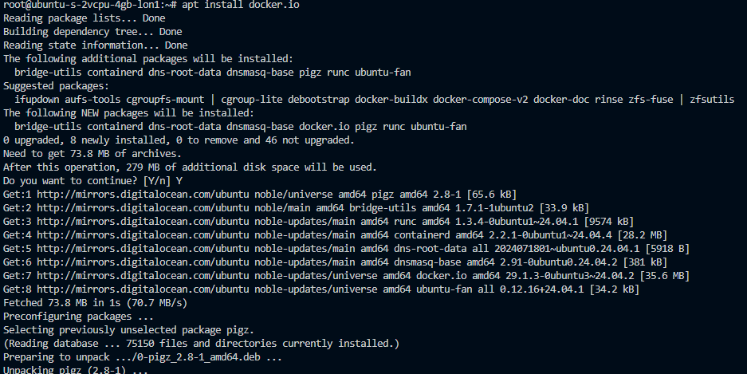

*Evidence 02 — Installing the Ubuntu `docker.io` package.*

```bash
docker --version
```

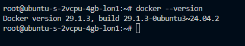

*Evidence 03 — Docker version 29.1.3 reported on the Ubuntu host.*

**Why this matters:** Docker is a host-level runtime; installing the CLI and engine enables the remote server to pull images and create containers. `docker --version` establishes the installed CLI version but does not alone prove daemon health. The later successful `docker run` and `docker ps` outputs provide operational confirmation that the daemon was usable.

**Alternative, not used in this project:** Installing Docker Engine from Docker's official APT repository is another supported route. Do not mix conflicting package installation methods without reviewing the packages already present.

---

## 06 — Preparing Persistent Storage for Nexus

Nexus stores repository configuration, databases, components and operational state under **`/nexus-data` inside its container**. If this directory were left only in the container's writable layer, removing the container could remove that state. A Docker named volume separates persistent application data from the container lifecycle.

I created and listed the volume:

```bash
docker volume create --name nexus-data
docker volume ls
```

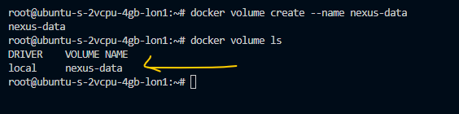

*Evidence 04 — `nexus-data` exists as a local Docker volume.*

A named volume is managed by Docker. It is **not** the same as manually mounting a specific host directory: Docker chooses and manages its host-side storage path. As with the MongoDB volume in Dev7c, the container accesses the data through a stable in-container mount point.

**Important distinction:** A named volume supports persistence, but the notes do not show a full remove/recreate/recovery test. The project confirms creation, attachment and inspection of stored files—not a completed recovery exercise.

---

## 07 — Pulling and Running the Nexus Container

I used the `sonatype/nexus3` image and started a detached container with its Nexus data directory backed by the named volume:

```bash
docker run -d \
  -p 8081:8081 \
  --name chioma_nexus \
  -v nexus-data:/nexus-data \
  sonatype/nexus3
```

| Argument | Purpose |
|---|---|
| `run` | Creates and starts a new container from the image |
| `-d` | Runs the container in detached mode |
| `-p 8081:8081` | Publishes host TCP port 8081 to container TCP port 8081 |
| `--name chioma_nexus` | Assigns a readable name for later management |
| `-v nexus-data:/nexus-data` | Mounts the named volume into Nexus's data directory |
| `sonatype/nexus3` | Identifies the Nexus Repository Manager image |

Docker did not initially find the image locally, so it pulled the required layers from the image registry before creating the container. No explicit image tag was supplied, so Docker used the image's default `latest` tag. For reproducible environments, pinning a reviewed version or digest is safer.

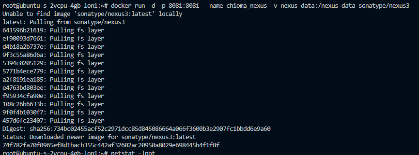

*Evidence 05 — Image layers downloaded and the `chioma_nexus` container launched.*

### Checking the listener and running container

The notes also show server-side listener inspection and `docker ps` output:

```bash
netstat -lptn
docker ps
```

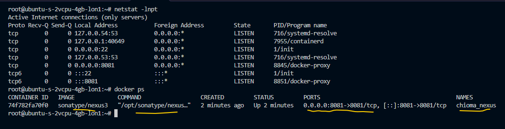

*Evidence 06 — Host listener inspection and a running container with port 8081 published.*

The `docker ps` output shows the Nexus container in the `Up` state. This confirms that its main process was running at the time, but does not independently prove full application readiness; the browser verification provides stronger application-level evidence.

---

## 08 — Accessing the Nexus Web Interface

I opened the remote Nexus interface in a browser using the Droplet's public address and published port:

```text
http://<DROPLET_PUBLIC_IP>:8081
```

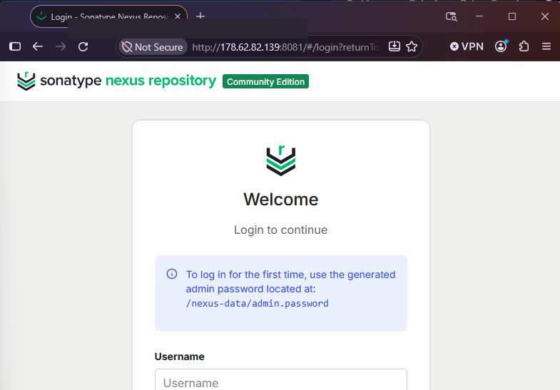

*Evidence 07 — Nexus welcome screen requesting the generated initial administrator password. Public IP obscured in the screenshot.*

The first-login screen instructs the administrator to retrieve a generated password from `/nexus-data/admin.password`. Because the volume is mounted at that location, the file is part of the persisted Nexus application data.

### Retrieving the initial password and troubleshooting shell access

My first attempt to enter the container used Bash:

```bash
docker exec -it chioma_nexus /bin/bash
```

That failed with an OCI runtime error reporting that `/bin/bash` did not exist. The issue was **not** that Nexus had stopped: the image simply did not provide Bash at that path.

I then used the available POSIX shell:

```bash
docker exec -it chioma_nexus /bin/sh
```

From inside the container, I read the initial password file:

```bash
cat /nexus-data/admin.password
```

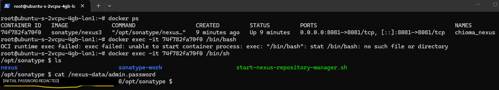

*Evidence 08 — Bash failure, successful `/bin/sh` access and reading the password file. The password value is not reproduced in this README.*

**Why the fallback worked:** The host Ubuntu installation and the Nexus image have separate filesystems and available executables. A shell present on the host is not necessarily present in the container. `docker exec` runs a program *inside the container*, so that executable must exist there.

**Security:** The generated administrator password is a secret. Do not commit it, include it in terminal transcripts, or publish unredacted screenshots. On first login, change the password and follow the application's initial setup prompts. The notes show access to the dashboard, but do not document the exact subsequent account-hardening steps.

### Dashboard verification

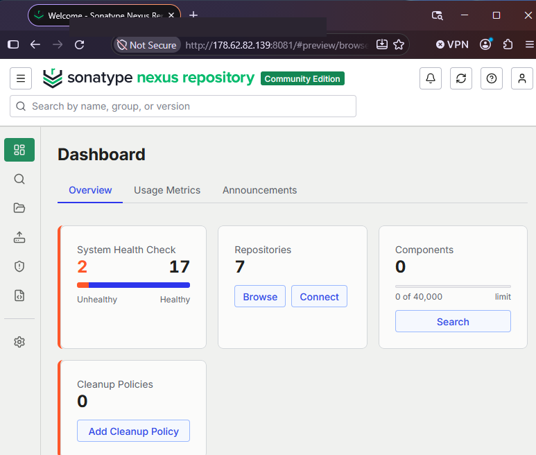

*Evidence 09 — Nexus dashboard successfully loaded after login. The screenshot displays system-health information; it does not establish that every health check passed.*

The dashboard confirms browser-level access to the deployed repository manager. The screenshot also displays a system-health summary with unhealthy checks; those would need investigation before treating the service as production-ready.

---

## 09 — Container User and Process Isolation

An interesting difference from my earlier host-managed Nexus installation was that I did **not** need to manually create a dedicated Linux user on the Droplet before launching this image. The image supplies its own runtime identity and filesystem setup.

Inside the running container I executed:

```bash
whoami
```

The output was:

```text
nexus
```

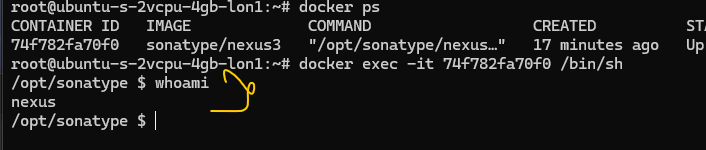

*Evidence 10 — `whoami` identifies the active container shell user as `nexus`.*

This is an important nuance: **Docker did not necessarily create a new host user named `nexus`**. The image defines or includes a user identity within its own filesystem and process environment. A `$` shell prompt is a convention often used for non-root sessions, but `whoami` is the stronger evidence here. User names inside containers do not by themselves guarantee host isolation; Linux permissions and numeric UIDs/GIDs still matter for mounted storage.

---

## 10 — Inspecting the Named Volume on the Host

To understand where Docker stores the persistent Nexus files, I inspected the volume:

```bash
docker volume inspect nexus-data
```

The output identified the host mountpoint:

```text
/var/lib/docker/volumes/nexus-data/_data
```

I then listed that directory on the Ubuntu host:

```bash
ls /var/lib/docker/volumes/nexus-data/_data
```

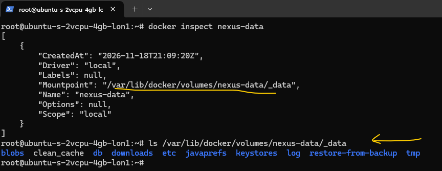

*Evidence 11 — Docker's named-volume mountpoint and Nexus data directories visible on the host.*

The screenshot shows Nexus data directories such as `blobs`, `db`, `etc`, `log` and `tmp`, providing direct evidence that application state is being written to the attached volume. The mountpoint shown is specific to this Docker host and storage driver; it should not be assumed identical in every environment.

**Operational caution:** Inspecting the path for learning is useful, but avoid manually editing Nexus's internal files while the service is running. Use supported administration and backup procedures for operational changes.

---

## 11 — Troubleshooting Record

| Observation | Investigation / explanation | Outcome |
|---|---|---|
| `docker` initially unavailable on the new server | Ubuntu suggested `docker.io` and `podman-docker`; selected the Docker Engine package | Docker installed and verified |
| `docker exec ... /bin/bash` failed with `no such file or directory` | Container image did not contain Bash at that path; host and container filesystems differ | Successfully entered with `/bin/sh` |
| Nexus needed data outside the container writable layer | Created `nexus-data` and mounted it at `/nexus-data` | Volume exists and contains Nexus files |
| Nexus dashboard displayed unhealthy checks | Observed in dashboard evidence; no investigation or resolution is recorded | **Open observation**, not claimed resolved |

There is no evidence in the notes of a failed image pull, a broken Docker daemon, a container crash, or a failed Nexus startup. Those outcomes are not attributed to this project.

---

## 12 — Engineering Lessons and Trade-offs

1. **Container images simplify installation.** A single image pull and `docker run` replaced much of the manual host-level application setup needed in a traditional deployment.
2. **Containerisation does not remove state.** Nexus still requires durable data storage; the volume is part of the application architecture, not an optional afterthought.
3. **Container and host environments differ.** The missing Bash executable illustrated that a container is not simply another shell on the Ubuntu host.
4. **Runtime identity is image-specific.** The `nexus` user observed inside the container should not be confused with an automatically provisioned Linux account on the Droplet.
5. **A running container is not the same as a healthy application.** Docker process status, browser reachability and Nexus's internal health checks measure different things.
6. **Fast deployment still requires security work.** Published ports, default credentials, TLS, version pinning and backups remain operational responsibilities.
